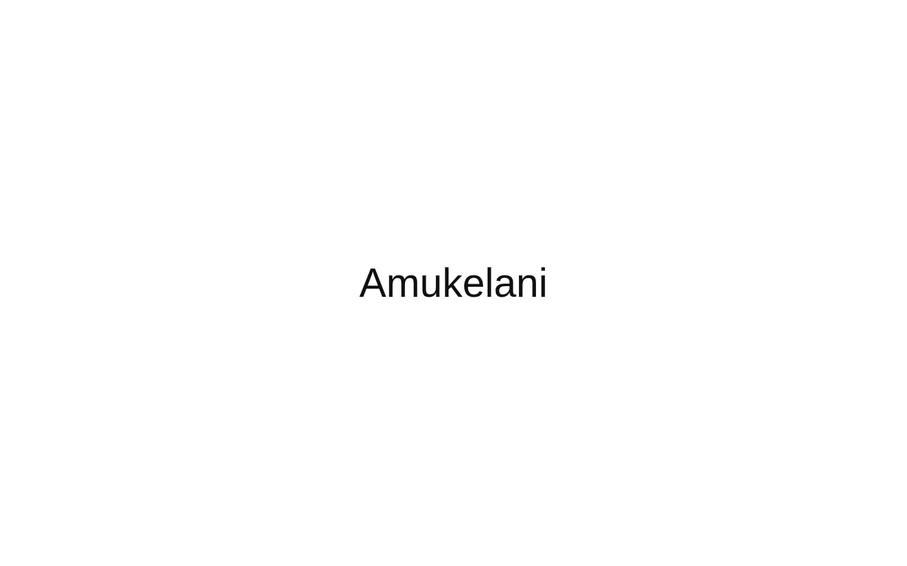

# Empty but live

A blank white page with “Amukelani” centered on the screen. Built with plain HTML and CSS; no dependencies or build step.

## Preview

Open `index.html` in your browser.

## Screenshots

Local browser previews at desktop (1440 × 900) and mobile (390 × 844) sizes. The mobile preview does not replace checking the live URL on a phone.

### Desktop

### Mobile

## Host on Vercel

Upload this project to a GitHub repository, then import the repository into Vercel as a new project.

- Framework Preset: **Other**
- Root Directory: repository root
- Build Command: leave empty
- Output Directory: **.** (the project root)

Deploy and use the production URL supplied by Vercel.

## Assignment checklist

- [x] Create the near-blank page.
- [ ] Deploy to Vercel and save the live URL.
- [ ] Open the live URL on your phone and take a screenshot.
- [ ] Add your identity kit, case studies, and content map to your Claude Project.

Deployment, the phone check, and the Claude Project uploads have not been completed by creating these files.
# FlyRank_EmptyButLive
